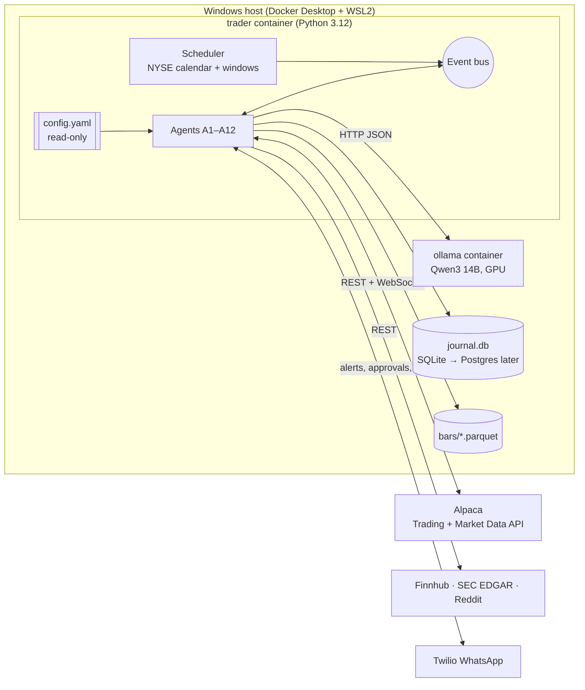
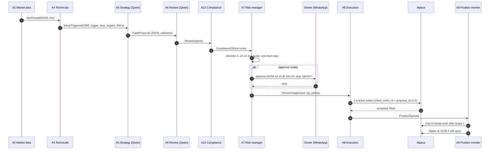
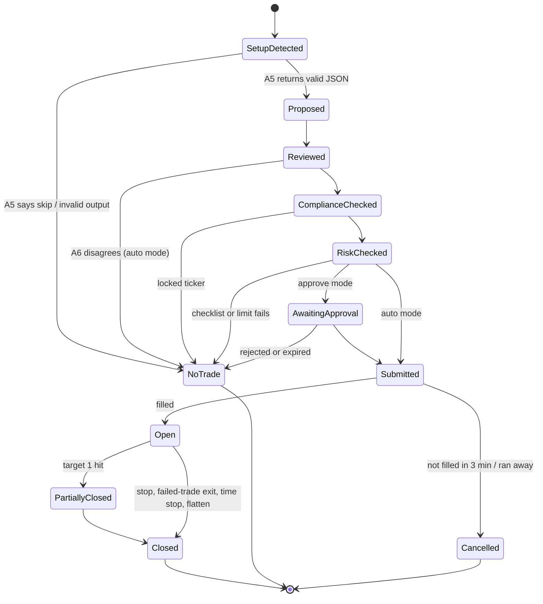

# Architecture

**Version:** 1.0 (September 30, 2026) · Companion to [REQUIREMENTS.md](REQUIREMENTS.md)

The system is one Python service plus a Qwen model server, both in Docker on the owner's Windows machine. Agents are modules inside the service, talking through an in-process event bus. Every event is also written to the journal database, so the journal is the system's memory and audit trail.

---

## 1. Runtime view



| Container | Image | Purpose | Restart policy |
| --- | --- | --- | --- |
| `trader` | Built from `docker/Dockerfile` | Scheduler, event bus, all agents | `unless-stopped` |
| `ollama` | `ollama/ollama` (pinned tag) | Serves Qwen over HTTP on port 11434 (internal network only) | `unless-stopped` |
| `grafana` (optional, phase 2) | `grafana/grafana` | Dashboards from the journal | `unless-stopped` |

**Why one service, not one container per agent:** the agents share state (levels, positions, locks) and must act within seconds. One process with an event bus is simpler to reason about, test and replay. Any agent can be split out later because all messages are already typed and journaled.

---

## 2. Repository layout

```
AIAgentsTrading/
├── README.md
├── config/
│   ├── config.example.yaml        # documented defaults (see CONFIG_REFERENCE.md)
│   └── config.yaml                # local copy, git-ignored if it holds anything private
├── docs/                          # this documentation set
├── docker/
│   ├── Dockerfile
│   └── docker-compose.yml
├── src/trader/
│   ├── main.py                    # entry point: load config, start scheduler and agents
│   ├── bus.py                     # typed event bus (asyncio queues)
│   ├── journal/                   # SQLAlchemy models, migrations, queries
│   ├── models/                    # Pydantic messages: Setup, TradeProposal, Review, Decision, ...
│   ├── agents/
│   │   ├── a01_universe.py
│   │   ├── a02_market_data.py
│   │   ├── a03_news_sentiment.py
│   │   ├── a04_technicals.py      # reuses the existing alert-bot indicator code
│   │   ├── a05_strategy.py
│   │   ├── a06_review.py
│   │   ├── a07_risk.py
│   │   ├── a08_execution.py
│   │   ├── a09_position_monitor.py
│   │   ├── a10_supervisor.py
│   │   ├── a11_reporter.py
│   │   └── a12_compliance.py
│   ├── brokers/alpaca_adapter.py  # the only module that talks to the Trading API
│   ├── llm/ollama_client.py       # the only module that talks to Qwen
│   ├── prompts/                   # versioned prompt files (see AGENT_PROMPTS.md)
│   └── notify/whatsapp.py
├── backtest/                      # replay engine using the same agents (BACKTEST_ENGINE.md)
├── tools/check_traceability.py    # CI: every rule ID has a test
├── .github/workflows/ci.yml       # from tools/ci.yml
├── pyproject.toml
└── tests/
    ├── unit/                      # one test file per rule ID (A7-1, WS-1, DR-3, ...)
    ├── contract/                  # same tests for real and fake interfaces (INTERFACES.md)
    ├── replay/                    # recorded market days replayed through the system
    └── chaos/                     # disconnects, timeouts, duplicate events
```

**Boundaries enforced in code review:**

- Only `brokers/alpaca_adapter.py` may import the Alpaca trading client, and only A8 and A9 may call it.
- Only `llm/ollama_client.py` may call Qwen. It never receives API keys, account numbers or order IDs.
- A5, A6 and A11 have no import path to the broker adapter.
- `config.yaml` is loaded once at start and frozen; no agent writes to it.

---

## 3. Event flow for one trade



Each arrow is a typed message written to the journal before it is delivered. If the process restarts, it rebuilds state from the journal and reconciles with Alpaca before accepting new entries.

---

## 4. Trade lifecycle states



Every terminal state records a reason code (for example `NT_FILTER_MF1`, `NT_EXPIRED`, `EXIT_TIME_STOP_1030`), which the reporter uses to explain each day.

---

## 5. Scheduling

| Job | Trigger (ET) | Agent |
| --- | --- | --- |
| Pre-flight | 7:00 trading days | A10 |
| News and calendar load | 7:15, then every 15 min until 4:00 | A3 |
| Level map | 8:00 | A4 |
| Morning game plan | 9:00 | A5 + A12 |
| Stream start | 9:25 | A2 |
| Morning window | 9:35–10:30 (entries until 10:15) | A4–A9 |
| Morning flatten | 10:30 | A9 |
| Afternoon plan | 2:45 | A5 |
| Afternoon window | 3:00–4:00 (day entries to 3:40, swing 3:30–3:50) | A4–A9 |
| Final flatten | 3:55 | A9 |
| Daily review | 4:30 | A11 |
| Weekly review | Friday 5:00 | A11 |
| Universe check | Sunday 6:00 PM | A1 |

The trading calendar comes from Alpaca's calendar endpoint (early closes included). The host clock is synced with NTP; A10 refuses to start if the clock is off by more than 2 seconds from Alpaca's server time.

---

## 6. Failure handling

| Failure | Detection | Response |
| --- | --- | --- |
| Market data stream drops | No message for 60 s in a window | Block entries, reconnect, back-fill, resume |
| Qwen container down or slow | Health check fails, or call > 60 s | Block entries (no trade without review); exits continue |
| Alpaca API errors | HTTP 5xx / timeouts | Retry with backoff; block entries after 3 failures; broker-side stops still protect positions |
| Process crash | Docker restarts container | Rebuild state from journal, reconcile with Alpaca, entries resume only after reconcile passes |
| Duplicate event | Same proposal ID seen twice | Ignored (idempotent client order IDs) |
| Host sleep or power loss | Heartbeat gap | On restart: reconcile, alert owner; broker-side brackets protected positions meanwhile |
| Clock drift | > 2 s vs Alpaca | Block entries and alert |

---

## 7. Windows host notes

- Docker Desktop with the WSL2 backend; NVIDIA GPU passed through to the `ollama` container (`gpus: all` in compose).
- Disable sleep and automatic restarts for updates during market hours (Windows Update active hours 6 AM–5 PM ET).
- Store `journal.db` and Parquet files on a local SSD volume, backed up nightly.
- If uptime proves unreliable, move the `trader` container to a small US-East cloud VM and keep `ollama` at home only if latency allows, or use a GPU VM.
