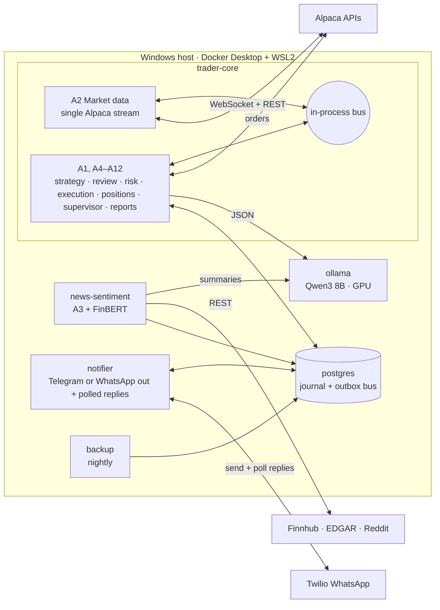
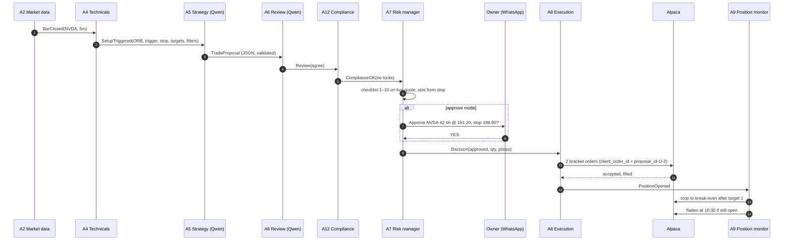
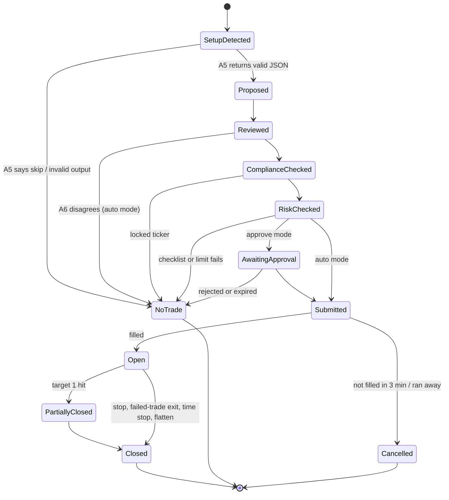

# Architecture

**Version:** 1.1 (September 30, 2026) · Companion to [REQUIREMENTS.md](REQUIREMENTS.md)

The system runs as **six always-on containers plus on-demand jobs** under Docker Compose on the owner's Windows machine. Containers are split where it buys isolation (heavy dependencies, untrusted text, GPU, internet-facing traffic) and kept together where the system needs one exact view of the truth (the decision-and-order path). Everything is written in Python 3.12 except SQL, YAML and the container definitions ([ADR-010](DECISIONS.md), [ADR-011](DECISIONS.md)).

---

## 1. Runtime view



### Containers

| # | Service | Image (target) | Runs | Network | Why it is separate |
| --- | --- | --- | --- | --- | --- |
| 1 | `ollama` | `ollama/ollama` (pinned digest) | Always | internal only | GPU, large model, no internet needed |
| 2 | `trader-core` | `docker/Dockerfile` target `core` | Always | internal + egress to Alpaca | The only container that can trade. Holds A1, A2, A4–A12 so the risk manager always sees exact positions, live quotes and limits in memory |
| 3 | `news-sentiment` | target `news` (adds PyTorch + FinBERT) | Always in market days | internal + egress to Finnhub, EDGAR, Reddit | Heavy image; reads untrusted text, so it is kept away from order code and holds no Alpaca keys |
| 4 | `notifier` | target `notifier` | Always | internal + egress to Telegram (default, ADR-014) or Twilio | Holds the channel keys; sends messages and **polls** for replies (Telegram `getUpdates` long polling or Twilio's Messages API), so nothing on the host is reachable from the internet |
| 5 | `postgres` | `postgres:16` (pinned) | Always | internal only | Journal, tax lots and the cross-container outbox bus |
| 6 | `backup` | target `tools` | Always (sleeps; runs nightly) | internal + local backup folder | Nightly `pg_dump` and Parquet copy |
| — | `replay` | target `core` | On demand (`--profile replay`) | internal only | Backtests and replays use the same code as live, with fake broker and data |
| — | `grafana` | `grafana/grafana:13.2.3` | Optional (`--profile monitoring`) | internal only (no internet, no port) | Dashboards read Postgres directly as `readonly`; no Prometheus needed ([MONITORING.md](MONITORING.md) §3) |
| — | `grafana-proxy` | `nginx:1.30.5-alpine` | With `grafana` | internal + monitoring, port bound to `127.0.0.1:3000` | Only forwards the browser to Grafana |
| — | dev container | target `dev` | Development | — | Same Python toolchain as production in VS Code |

### Why this split and not more

| Option considered | Decision | Reason |
| --- | --- | --- |
| One container per agent (12+) | Rejected | Agents A4–A12 share fast-changing state (quotes, positions, locks, limits). Splitting them adds network hops and race conditions to the one path that must be exact |
| Market data as its own container | Rejected | Alpaca allows **one** market-data WebSocket connection on most plans ([Alpaca docs](https://docs.alpaca.markets/us/docs/streaming-market-data)); the risk manager needs live quotes in memory, so the stream lives in `trader-core` |
| Redis or NATS message bus | Rejected for v1 | Cross-container messages are low-rate (news flags, commands, approvals, reports). A Postgres outbox table with `LISTEN/NOTIFY` gives "journaled before delivered" for free with one fewer service |
| Webhook + tunnel for WhatsApp replies | Rejected | Needs a public endpoint into the home PC. Twilio's Messages API can list inbound WhatsApp messages ([Twilio docs](https://www.twilio.com/docs/messaging/api/message-resource)), so the notifier polls instead: outbound-only, no tunnel |
| Prometheus for metrics | Deferred | All metrics come from the journal; Grafana reads Postgres directly |
| SQLite journal | Replaced by Postgres | Several containers write to the journal |

### How containers talk

| From → To | Mechanism | Examples |
| --- | --- | --- |
| Inside `trader-core` | In-process typed event bus (asyncio), each event written to Postgres before delivery | Bars, setups, proposals, decisions, orders |
| `news-sentiment` → `trader-core` | Outbox row + `NOTIFY news_flags` | Sentiment, summaries, event flags |
| `trader-core` → `notifier` | Outbox row + `NOTIFY outbound_msg` | Approvals, alerts, reports |
| `notifier` → `trader-core` | Outbox row + `NOTIFY inbound_cmd` (only after SEC-1..3 checks) | `YES K7Q2`, `KILL`, `FLATTEN` + confirmation |
| Any → `ollama` | HTTP JSON on the internal network | Structured Qwen calls |

If Postgres is down, `trader-core` blocks new entries (no journal, no trade) while broker-side brackets keep protecting open positions.

---

## 2. Repository layout

```
agentic-ai-trading-system/
├── README.md
├── .devcontainer/devcontainer.json   # from tools/devcontainer.json (protected folder; copy manually)
├── config/
│   ├── config.example.yaml           # documented defaults (CONFIG_REFERENCE.md)
│   ├── macro_calendar_2026_2027.yaml
│   └── config.yaml                   # local copy, git-ignored
├── docs/
├── docker/
│   ├── Dockerfile                    # multi-stage: base, core, news, notifier, tools, dev
│   ├── docker-compose.yml            # 6 services + replay and monitoring profiles
│   └── postgres/init.sql             # roles: core_rw, news_rw, notifier_rw, readonly
├── src/trader/
│   ├── cli.py                        # `trader run|replay|status|kill|flatten|validate-config|health`
│   ├── bus.py                        # in-process bus + Postgres outbox bridge
│   ├── journal/                      # SQLAlchemy models, Alembic migrations
│   ├── models/                       # Pydantic messages
│   ├── agents/                       # a01_universe.py … a12_compliance.py
│   ├── services/
│   │   ├── core_main.py              # entry point for trader-core
│   │   ├── news_main.py              # entry point for news-sentiment
│   │   └── notifier_main.py          # entry point for notifier
│   ├── brokers/alpaca_adapter.py     # only module that talks to the Trading API
│   ├── llm/ollama_client.py          # only module that talks to Qwen
│   ├── prompts/
│   └── notify/whatsapp.py
├── backtest/                         # replay engine (BACKTEST_ENGINE.md)
├── tools/
│   ├── check_traceability.py
│   ├── ci.yml                        # copy to .github/workflows/ci.yml (protected folder)
│   └── devcontainer.json             # copy to .devcontainer/devcontainer.json
├── pyproject.toml
└── tests/
    ├── unit/
    ├── contract/
    ├── replay/
    └── chaos/
```

**Boundaries enforced in code review and by container wiring:**

- Only `trader-core` has Alpaca keys; only `brokers/alpaca_adapter.py` uses the trading client.
- Only `notifier` has Twilio keys; only `news-sentiment` has Finnhub and Reddit keys.
- `ollama` and `postgres` are on the internal network only; no host ports are published except `grafana-proxy` on `127.0.0.1:3000` (Grafana itself stays internal).
- Each service uses its own Postgres role with access only to the tables it needs (`docker/postgres/init.sql`).
- `config.yaml` is mounted read-only into every container.

## 3. Event flow for one trade



Each arrow is a typed message written to the journal before it is delivered. If the process restarts, it rebuilds state from the journal and reconciles with Alpaca before accepting new entries.

---

## 4. Trade lifecycle states



Every terminal state records a reason code (for example `NT_FILTER_MF1`, `NT_EXPIRED`, `EXIT_TIME_STOP_1030`), which the reporter uses to explain each day.

---

## 5. Scheduling

| Job | Trigger (ET) | Agent |
| --- | --- | --- |
| Pre-flight | 7:00 trading days | A10 |
| News and calendar load | 7:15, then every 15 min until 4:00 | A3 |
| Level map | 8:00 | A4 |
| Morning game plan | 9:00 | A5 + A12 |
| Stream start | 9:25 | A2 |
| Morning window | 9:35–10:30 (entries until 10:15) | A4–A9 |
| Morning flatten | 10:30 | A9 |
| Afternoon plan | 2:45 | A5 |
| Afternoon window | 3:00–4:00 (day entries to 3:40, swing 3:30–3:50) | A4–A9 |
| Final flatten | 3:55 | A9 |
| Daily review | 4:30 | A11 |
| Weekly review | Friday 5:00 | A11 |
| Universe check | Sunday 6:00 PM | A1 |

The trading calendar comes from Alpaca's calendar endpoint (early closes included). The host clock is synced with NTP; A10 refuses to start if the clock is off by more than 2 seconds from Alpaca's server time.

---

## 6. Failure handling

| Failure | Detection | Response |
| --- | --- | --- |
| Market data stream drops | No message for 60 s in a window | Block entries, reconnect, back-fill, resume |
| Qwen container down or slow | Health check fails, or call > 60 s | Block entries (no trade without review); exits continue |
| Alpaca API errors | HTTP 5xx / timeouts | Retry with backoff; block entries after 3 failures; broker-side stops still protect positions |
| `trader-core` crash | Docker restarts container | Rebuild state from journal, reconcile with Alpaca, entries resume only after reconcile passes |
| Duplicate event | Same proposal ID seen twice | Ignored (idempotent client order IDs) |
| Host sleep or power loss | Heartbeat gap | On restart: reconcile, alert owner; broker-side brackets protected positions meanwhile |
| Clock drift | > 2 s vs Alpaca | Block entries and alert |
| `news-sentiment` down | No heartbeat in outbox for 5 min | Entries continue only for setups without a news requirement; GAP_AND_GO disabled; alert |
| `notifier` down | No heartbeat for 2 min | Approve mode cannot get answers, so entries are blocked; auto mode continues; local `trader kill` still works |
| `postgres` down | Connection fails | Block entries (no journal, no trade); exits continue in memory and are journaled when Postgres returns |

---

## 7. Windows host notes

- Docker Desktop with the WSL2 backend; NVIDIA GPU passed through to the `ollama` container (`gpus: all` in compose), tuned for an 8 GB card (one model, one request at a time, flash attention, 8-bit KV cache). `trader check-connections --service llm` reports how much of the model is in GPU memory ([ACCOUNT_SETUP.md](ACCOUNT_SETUP.md) §0).
- Disable sleep and automatic restarts for updates during market hours (Windows Update active hours 6 AM–5 PM ET).
- Keep the Postgres volume and the Parquet bar files on a local SSD, backed up nightly by the `backup` container.
- If home uptime proves unreliable, the same Compose file runs on a US-East cloud VM; `ollama` needs a GPU VM there, or Qwen calls stay at home over a private VPN (Tailscale) with entries blocked whenever the link is down.
