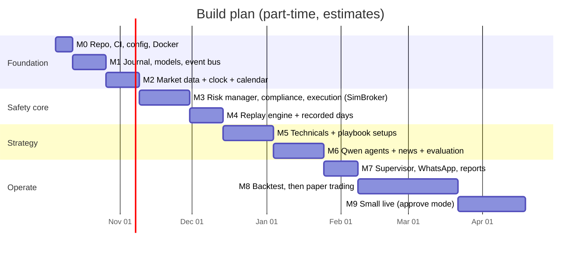

# Implementation Plan

**Version:** 1.0 (September 30, 2026) · Companion to [REQUIREMENTS.md](REQUIREMENTS.md) and [TEST_PLAN.md](TEST_PLAN.md)

The build order puts safety first: journal, data and the risk manager exist before any agent can propose a trade, and the replay engine exists before any strategy is trusted. Estimates assume part-time work of about 10–12 hours a week.

---

## Milestones

From October 17, 2026, the remaining work, including M8 (backlog B10) and M9 (B18), is ordered in [BACKLOG.md](BACKLOG.md).

### M0 — Repository and tooling (1 week)

- [ ] Python package skeleton under `src/trader/` per ARCHITECTURE.md §2
- [ ] `pyproject.toml`; generate hashed lock files per image in `requirements/` (`base`, `core`, `news`, `notifier`, `dev`) with `pip-compile --generate-hashes`
- [ ] CI workflow green on an empty test suite; gitleaks secret scan on
- [ ] Config loader with every validation rule in CONFIG_REFERENCE.md; `trader validate-config`
- [ ] `docker compose up` starts all six services healthy: `postgres` with per-service roles, `ollama` with the GPU visible, and stub `trader-core`, `news-sentiment`, `notifier`, `backup` that report health
- [ ] Dev container opens in VS Code (`.devcontainer/devcontainer.json`); CI runs from `.github/workflows/ci.yml`
- **Done when:** a bad config value (for example `risk_per_trade_pct: 2`) makes `trader validate-config` fail with the rule name.

### M1 — Journal, message models, event bus (2 weeks)

- [ ] SQLAlchemy models and migrations for every table in DATA_SPEC.md §3
- [ ] Pydantic message types (DATA_SPEC.md §4) and the `TradeProposal` schema (AGENT_PROMPTS.md §5)
- [ ] In-process event bus in `trader-core`: publish = write to journal, then deliver; replay from journal on start
- [ ] Postgres outbox bus between containers with the role and channel trigger (SEC-17); Alembic migrations
- [ ] Interfaces and fakes from INTERFACES.md; contract test harness
- **Done when:** a test publishes 1,000 events, kills the process, restarts, and the rebuilt state matches.

### M2 — Market data, clock and calendar (2 weeks)

- [ ] `AlpacaStream` streaming 13 symbols; reconnect and REST back-fill (A2-4, DQ-5)
- [ ] Bar store (Parquet) with 2 years daily and 60 days of 1-min history
- [ ] Indicators in DATA_SPEC.md §2 (VWAP, OR, RVOL by time of day, ATRs, EMAs)
- [ ] `MarketCalendar` (XNYS) with, macro calendar file, NTP drift check
- [ ] Start recording full days (bars, quotes, news) for the replay library
- **Done when:** a week of live recording has no unrecovered gaps and indicators match a reference calculation to the cent.

### M3 — Safety core: risk manager, compliance guard, execution (3 weeks)

- [ ] A7 checklist, sizing algorithm (STRATEGY_SPEC.md §6), every loss and behaviour limit
- [ ] A12 wash-sale locks, tax lots, earnings and streak locks
- [ ] A8 bracket orders, idempotent IDs, cancel rules, reconcile; `SimBroker` for tests
- [ ] A9 exits: partials, break-even, trails, time stops, flatten
- [ ] Unit tests for every rule ID listed in TRACEABILITY.md for A7, A8, A9, A12
- **Done when:** the traceability check passes for all safety rules and the chaos tests for duplicates and restarts pass against `SimBroker`.

### M4 — Replay engine and recorded-day library (2 weeks)

- [ ] Replay runner per BACKTEST_ENGINE.md, using the same agents and `ReplayClock`
- [ ] At least 30 recorded days covering the cases in TEST_PLAN.md RP-1
- [ ] Deterministic re-runs (RP-2) and journal diff between runs (RP-3)
- **Done when:** replaying the same day twice gives byte-identical decision logs.

### M5 — Technical analysis and playbook setups (3 weeks)

- [ ] A4 levels, filters MF-1..5, and the eight setups exactly per STRATEGY_SPEC.md
- [ ] Reuse alert-bot indicator code per ALERT_BOT_REUSE.md
- [ ] Setup detection tests on hand-labelled bars for each setup and edge case
- **Done when:** each setup fires on its labelled examples and not on its counter-examples, in replay and in unit tests.

### M6 — Qwen agents, news and evaluation (3 weeks)

- [ ] `OllamaClient` with schema-constrained output, timeouts, retries, logging (QW-1..5)
- [ ] A3 news pipeline (Finnhub, EDGAR, Reddit, FinBERT) with text cleaning (DQ-4)
- [ ] A5 game plan and proposals; A6 review; prompt files v1
- [ ] Evaluation set from AGENT_PROMPTS.md §8, run in CI nightly against the local model
- **Done when:** the evaluation pass bars are met and replay days run end to end with Qwen in the loop.

### M7 — Supervisor, notifications and reports (2 weeks)

- [ ] A10 schedule, health checks, kill switch, modes
- [ ] `notifier` container: WhatsApp sending and Twilio reply polling (ADR-013), sender allow-list, approval codes and two-step confirmation (SECURITY.md SEC-1..3)
- [ ] A11 reports per REPORT_TEMPLATES.md; monitoring per MONITORING.md
- **Done when:** a full replayed week produces every report, and all chaos tests in TEST_PLAN.md §6 pass.

### M7a — Day-trader gaps, part 1 (2 weeks, before M8 results are judged)

From REQUIREMENTS 1.3 ([REQUIREMENTS_REVIEW.md](REQUIREMENTS_REVIEW.md) P1):

- [ ] Latency budget, pre-arming, no-chase at send, aligned expiries (LAT-1..LAT-4, A5-5)
- [ ] Reliable-quote rule and IEX-vs-SIP divergence report (MF-6, DQ-6, DQ-8)
- [ ] 10:00 AM release and Fed-speech block (TW-6); 60-second news and shock rule in positions (NW-1, NW-2)
- [ ] Core-produced, labelled, actionable alerts (AL-1..AL-3); stop order type (EX-5); account settlement (AC-1, AC-2)
- [ ] Shadow trades (SH-1) from the first paper day, so M8 has the comparison data
- **Done when:** a replay day shows trigger-to-order p95 ≤ 10 s with pre-arming, and every missed trigger has a reason code and a shadow result.

- [ ] Walk-forward backtest (TEST_PLAN.md stage 3) and its pass bar
- [ ] 20+ trading days and 100+ trades on the Alpaca paper account (stage 4)
- [ ] Weekly reviews; tune only through config versions (CF-1..3)
- **Done when:** all acceptance tests in REQUIREMENTS.md §11 pass and the gate is recorded.

### M8a — Day-trader gaps, part 2 (during paper trading)

- [ ] Shadow report (SH-2); slippage feedback (EXQ-1); stricter paper fills (PT-4); real-history backtest (BT-6)
- [ ] Chart, button and live-status approvals (AP-1..AP-3); co-pilot mode (CP-1..CP-3); notifier fallback (NF-1)
- [ ] Regime and trend day (RG-1..RG-3); in-play scan (UN-1); alert caps, ranking and grading (AL-4..AL-7)
- [ ] Monthly restore test and emergency drill (OPS-1, OPS-2); other-broker import (WS-9); tax set-aside (TX-1)
- **Done when:** the new acceptance tests in REQUIREMENTS.md §11 pass alongside the existing ones.

### M9 — Small live, approve mode (4 weeks)

- [ ] Go-live checklist in RUNBOOK.md §6
- [ ] 0.25% risk per trade for the first 20 trades; approve every trade
- [ ] Compare live with paper (TEST_PLAN.md LV-2)
- **Done when:** 40 live trades meet the performance standards; then decide on auto mode per style.

## Dependencies and risks

| Risk | Effect | Mitigation |
| --- | --- | --- |
| Free IEX data too thin for RVOL and ORB volume checks | False or missed signals | Measured in M4–M5 replays; upgrade path ADR-003 ($99/month feed) |
| Qwen 14B too slow or unreliable on the local GPU | Missed day-trade entries | Measure latency in M6; 8B fallback; keep A6 prompt short |
| Strategy has no edge after costs | No go-live | Expected possibility; the plan stops at M8 without risking money |
| Home PC uptime | Missed exits (protected by broker stops) | Measured in M8; move `trader` to a cloud VM if needed |
| Scope creep (options, shorting, more tickers) | Delays the safety core | Out of scope for v1 (REQUIREMENTS.md §1) |
