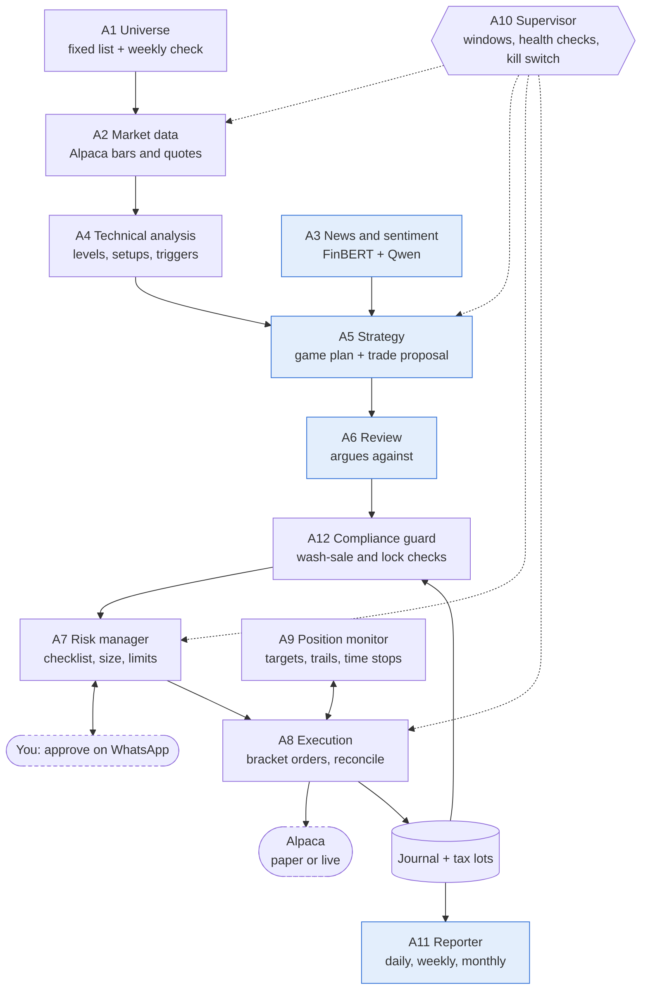

# Trading Agents: Requirements Specification

**Version:** 1.3 (October 10, 2026)
**Owner:** Srinivasa Rao Bittla
**Status:** Draft for build

The system trades only a fixed list of 10 large-cap US stocks, through Alpaca, using free data and a Qwen model running locally in Docker. It trades only in the first hour and the last hour of the session, and only when an A-grade entry exists: **no setup, no trade**. It runs in paper mode first and never places an order that skips the risk manager.

> No system can guarantee it will not lose money. These requirements are built to make losses small, rare and capped, and to stop trading before a bad day becomes a bad month. This is a design for personal research and automation, not financial or tax advice.

**Related documents:** [Architecture](ARCHITECTURE.md) · [Data spec](DATA_SPEC.md) · [Agent prompts](AGENT_PROMPTS.md) · [Config reference](CONFIG_REFERENCE.md) · [Test plan](TEST_PLAN.md) · [Runbook](RUNBOOK.md) · [Decisions](DECISIONS.md) · [Strategy spec](STRATEGY_SPEC.md) · [Security](SECURITY.md) · [Interfaces](INTERFACES.md) · [Implementation plan](IMPLEMENTATION_PLAN.md) · [Traceability](TRACEABILITY.md)

### What changed in 1.3

Gaps found in the day-trader review ([REQUIREMENTS_REVIEW.md](REQUIREMENTS_REVIEW.md)) are now requirements:

- **Speed:** trigger-to-order latency budget, pre-armed model calls, no-chase re-check at order time, aligned expiries (LAT-1..LAT-4; A5-4, A5-5, §10.1).
- **Data quality:** IEX vs consolidated divergence measured, go-live data gate, no trade on unreliable quotes (DQ-6..DQ-8).
- **Events and news:** 10:00 AM releases and Fed speakers blocked (TW-6); 60-second news in positions and a price-shock rule (NW-1, NW-2).
- **Market regime:** volatility regime and an objective trend-day definition (RG-1..RG-3).
- **Execution:** stop order types (EX-5), slippage acted on (EXQ-1), stricter paper fills (PT-4).
- **Account:** cash vs margin settlement rules (AC-1, AC-2).
- **Learning:** shadow trades for every triggered setup (SH-1, SH-2); real-history backtest before paper trading (BT-6).
- **Owner workflow:** qualified, actionable and graded alerts (AL-1..AL-7); chart, button and live-distance approvals (AP-1..AP-3); co-pilot mode for manual execution (CP-1..CP-3); fallback when the notifier is down (NF-1).
- **Universe:** pre-market in-play scan (watch only) and a governed rotation path (UN-1, UN-2).
- **Operations and tax:** monthly restore and emergency drills (OPS-1, OPS-2); other-broker trade import for wash sales (WS-9); tax set-aside estimate (TX-1).

### What changed in 1.2

- Checklist item 8 clarified (resistance at least 1.5R above entry; T2 at least 2R), matching [STRATEGY_SPEC.md](STRATEGY_SPEC.md).
- IDs added to the checklist (CK-1..CK-10), loss limits (LL-1..LL-11) and exit rules (XR-1..XR-6) so every rule is traceable ([TRACEABILITY.md](TRACEABILITY.md)).
- Exact setup rules now live in STRATEGY_SPEC.md; security controls in SECURITY.md.
- Fully containerized runtime (six services) with Postgres as journal and bus and outbound-only notifications: SR-6, A10-2 updated ([ARCHITECTURE.md](ARCHITECTURE.md), ADR-010 to ADR-013).

### What changed in 1.1

- Trading windows: entries and exits only in the first hour (9:30–10:30 AM ET) and last hour (3:00–4:00 PM ET).
- A day-trader playbook: pre-market preparation, named setups per window, an entry checklist, exit rules.
- A no-trade rule: no qualifying entry means no trade, and the system logs why.
- Capital-protection rules: daily, weekly and monthly loss limits, loss-streak stops, no averaging down, size reduction in drawdowns.
- A wash-sale prevention process and a new agent, A12 Compliance guard.
- A daily operating process from 7:00 AM preparation to the 4:30 PM review, plus weekly and monthly reviews.

---

## Contents

1. [Scope and decisions](#1-scope-and-decisions)
2. [Trading universe](#2-trading-universe)
3. [Trading windows](#3-trading-windows)
4. [Daily operating process](#4-daily-operating-process)
5. [Day-trader playbook](#5-day-trader-playbook)
6. [Discipline and capital protection](#6-discipline-and-capital-protection)
7. [Wash-sale prevention process](#7-wash-sale-prevention-process)
8. [Agent roster](#8-agent-roster)
9. [Requirements per agent](#9-requirements-per-agent)
10. [Shared requirements](#10-shared-requirements)
11. [Acceptance tests](#11-acceptance-tests)
12. [Open questions](#12-open-questions)
13. [Sources](#13-sources)

---

## 1. Scope and decisions

| Decision | Choice | Why it matters |
| --- | --- | --- |
| Broker | Alpaca (paper first, then live) | Official API, $100K paper account, commission-free stocks |
| Model | Qwen in Docker (Ollama), on the local machine | No API cost; structured JSON output is supported; reasoning is weaker than paid models, so rules carry more weight |
| Data | Free sources only | Alpaca free feed (IEX), Finnhub, SEC EDGAR, Reddit |
| Universe | The owner's fixed list of 10 large-cap stocks (section 2) | Very liquid, tight spreads, heavy news coverage; fits Alpaca's 30-symbol free stream |
| Trading hours | First hour and last hour only | Most volume and the cleanest moves; avoids the midday chop |
| Styles | Day trades (primary) and swing trades (secondary) | Each trade is tagged one or the other at entry and managed by that style's rules |
| Direction | Long only to start | Shorting adds borrow and margin rules; add later if wanted |
| Default action | No trade | A trade happens only when every checklist item passes |

**Out of scope for v1:** option *orders*, shorting stock, crypto, any stock outside the list, Webull, Robinhood. **Planned next (draft, not built):** advisory options suggestions and alerts for bullish and bearish views, defined risk only, bearish views via puts and put spreads, never by shorting stock: [OPTIONS_REQUIREMENTS.md](OPTIONS_REQUIREMENTS.md) (agents A13–A16, ADR-015 proposed).

---

## 2. Trading universe

The system trades **only the 10 stocks on the owner's list**. The list lives in config and changes only when the owner edits it. Starting list (top 10 US-listed by market cap, September 29, 2026):

| # | Ticker | Company | Market cap (Sep 29, 2026) |
| --- | --- | --- | --- |
| 1 | NVDA | Nvidia | $5.49T |
| 2 | AAPL | Apple | $4.81T |
| 3 | GOOGL | Alphabet (Class A only) | $4.17T |
| 4 | MSFT | Microsoft | $3.78T |
| 5 | AMZN | Amazon | $2.66T |
| 6 | TSM | Taiwan Semiconductor (ADR) | $2.37T |
| 7 | SPCX | SpaceX | $1.97T |
| 8 | META | Meta Platforms | $1.88T |
| 9 | AVGO | Broadcom | $1.70T |
| 10 | TSLA | Tesla | $1.39T |

**Context symbols (watched, never traded):** SPY, QQQ, SMH. They tell the agents whether the market and the chip sector are with or against a trade.

### Universe rules

- **UR-1:** Trade only tickers on the config list. Any proposal for another ticker is rejected and logged.
- **UR-2:** One share class per company (GOOGL, never GOOG; they are treated as the same stock for wash sales).
- **UR-3:** Each ticker must be tradable on Alpaca and have at least 60 trading days of history. SPCX must be checked against this rule.
- **UR-4:** Every Sunday, A1 reports the current top 10 by market cap next to the owner's list and flags differences. It never changes the list on its own.
- **UR-5:** Store the list with its effective date so backtests use the list that was active at the time.
- **UN-1 In-play scan (watch only):** from 8:30 to 9:25 AM, scan the 50 largest S&P 500 names for gap %, pre-market volume against their average, and news flags. The 9:00 game plan lists the top 5 as "in play, not tradable", with levels. They count toward the 30-symbol stream limit only if the owner adds them to the watchlist.
- **UN-2 Governed rotation:** A1's weekly report may propose swapping a list ticker for a name that was in play on at least 3 of the last 5 days and passes UR-3. Only the owner changes the list (config); the change applies from the next Monday, and UR-5 records it.

---

## 3. Trading windows

All times are US Eastern. Outside the windows, the system places no new orders except protective exits.

| Window | Time | What is allowed |
| --- | --- | --- |
| Opening noise | 9:30–9:35 | Observe only. Build the opening range. No entries. |
| **Morning window** | **9:35–10:30** | Day-trade entries 9:35–10:15; manage and exit. |
| Morning exit deadline | 10:30 | Every morning day trade is closed by 10:30. |
| Midday | 10:30–3:00 | No new entries. Broker-side stops on swing positions stay active. |
| **Afternoon window** | **3:00–4:00** | Day-trade entries 3:00–3:40; swing entries 3:30–3:50; manage and exit. |
| Afternoon exit deadline | 3:55 | Every day trade is closed by 3:55. |

- **TW-1:** Window times are config values, but no entry can be configured inside 9:30–9:35 or after 3:50.
- **TW-2:** A morning trade that hits neither stop nor target is closed at 10:30 with a marketable limit order (time stop).
- **TW-3:** Swing trades enter only in the afternoon window, near the close, so the daily candle is nearly complete.
- **TW-4:** Half days (early 1:00 PM close): only the morning window runs.
- **TW-5:** Scheduled high-impact events: on CPI and jobs-report days (8:30 AM releases) the morning entries start at 9:45 instead of 9:35; on FOMC days the afternoon window is skipped entirely.
- **TW-6 10:00 AM releases and Fed speakers:**
  - The macro calendar also lists the 10:00 AM releases (ISM, JOLTS, consumer sentiment, new home sales and the like) and scheduled Fed speeches.
  - On those days, no new entries from 9:57 to 10:05 (or 3 minutes before to 5 minutes after a speech inside a window).
  - Open day trades at +0.5R or better by the cut-off get their stop moved to break-even.
  - A missing or out-of-date calendar blocks the morning window (same rule as TW-5).

---

## 4. Daily operating process

The system follows the same process every trading day. Each step writes to the journal.

| Time (ET) | Step | Owner agent | Output |
| --- | --- | --- | --- |
| 7:00 AM | Health check: Alpaca, data, all containers, clock, account | A10 | Go / no-go for the day |
| 7:15 AM | Load overnight news, 8-K filings, earnings calendar, macro calendar | A3 | Event flags per ticker |
| 8:00 AM | Mark key levels per ticker: prior day high, low, close; pre-market high and low; 20/50-day EMAs | A4 | Level map |
| 8:30 AM | In-play scan of the 50 largest S&P 500 names (UN-1); daily volatility regime (RG-1) | A4 | Watch list, regime |
| 9:00 AM | Build the **game plan**: which tickers are in play, the setup to watch, the trigger price, the stop and the target; which tickers are off-limits today (earnings, wash-sale lock, loss streak) | A5 + A12 | Game plan (sent to WhatsApp) |
| 9:30–9:35 | Observe; build the opening range | A2, A4 | Opening range per ticker |
| 9:35–10:30 | Morning window: trade only game-plan setups that trigger | A4–A9 | Trades or "no trade" log |
| 10:30 | Flatten morning day trades; morning summary | A9, A11 | Morning P&L |
| 2:45 PM | Refresh game plan for the afternoon | A5 | Afternoon plan |
| 3:00–4:00 | Afternoon window | A4–A9 | Trades or "no trade" log |
| 3:55 PM | Flatten all day trades | A9 | Flat book (except swing) |
| 4:30 PM | Daily review: each trade graded A/B/C, rule breaches, missed setups | A11 | Daily report |
| Friday 5:00 PM | Weekly review: expectancy per setup, per ticker, per window | A11 | Weekly report; setups with negative expectancy go back to paper |
| Month end | Monthly review, tax lot and wash-sale report, tax set-aside estimate (TX-1); restore test and emergency drill (OPS-1, OPS-2) | A11, A12, owner | Monthly report, drill log |

---

## 5. Day-trader playbook

The agents analyze like a disciplined professional day trader: they plan before the open, trade only defined setups at defined levels, size from the stop, and cut losers fast.

### 5.1 Market and stock filters (must pass before any setup is considered)

- **MF-1 Market:** For long trades, QQQ is above its VWAP and not down more than 1% on the day. If QQQ is below VWAP, only A+ setups with relative strength are allowed (stock above VWAP while QQQ is below).
- **MF-2 Sector:** For NVDA, AVGO and TSM, SMH must also be above VWAP.
- **MF-3 Stock in play:** Relative volume (RVOL) at least 1.5 for the time of day, measured against the same IEX feed's history.
- **MF-4 Spread:** Bid-ask spread under 0.05% of price at the moment of entry.
- **MF-5 Clean data:** No trading halt, no stale data, no limit-up/limit-down band in the last 10 minutes.
- **MF-6 Reliable quote:** the spread check (MF-4) uses only a two-sided quote less than 2 seconds old (DQ-8).

### 5.1a Market regime

- **RG-1 Daily regime:** at 8:30 AM, classify the day as `normal` or `high-vol` from SPY's ATR(14-day) against its 60-day average (high-vol when above 1.5×) and from the opening gap. VIXY can serve as a proxy, since Alpaca has no index data. The regime appears in the game plan.
- **RG-2 High-vol rules:** risk per trade halves (like RC-1, not stacked below 0.25%); no gap-and-go when the gap is over 2× the stock's normal gap; the stop width limit (CK-7) is unchanged, so fewer setups qualify.
- **RG-3 Trend day, defined:** by 3:00 PM, at least 80% of 5-minute closes since 9:30 are above VWAP (below, for bearish options ideas), and the day's high was made after 1:00 PM. Setups marked "trend days only" (power-hour breakout, VWAP trend continuation) require it.

### 5.2 Morning setups (9:35–10:15 entries)

| Setup | Trigger | Stop | Notes |
| --- | --- | --- | --- |
| Opening range breakout (ORB) | 5-minute candle closes above the 5- or 15-minute opening-range high with RVOL ≥ 1.5 | Below the opening-range low, or the midpoint if the range is wider than 1 ATR(5-min) | Strongest when the stock gapped up on news |
| Gap-and-go | Gap up ≥ 1% on news holds above the pre-market high after the first 5 minutes | Below the pre-market high or the first 5-minute low | Skip if the gap is over 3x ATR(14-day) (exhaustion risk) |
| VWAP reclaim | Stock dips below VWAP then a 5-minute candle closes back above with rising volume | Below the low of the dip | Needs MF-1 to pass |
| First pullback | After a strong first move, first pullback to VWAP or the 9-EMA on the 5-minute chart holds | Below the pullback low | Entry on the break of the pullback candle's high |

### 5.3 Afternoon setups (3:00–3:40 day entries; 3:30–3:50 swing entries)

| Setup | Trigger | Stop | Notes |
| --- | --- | --- | --- |
| Power-hour breakout | Break of the high of day after 3:00 with RVOL rising | Below the last 15-minute higher low | Trend days only (RG-3) |
| VWAP trend continuation | Pullback to VWAP holds in an up-trend day; 5-minute candle closes off VWAP | Below VWAP by 0.25 ATR(5-min) | Trend days only (RG-3) |
| Swing: close near high | Daily candle closing in the top 25% of its range, above the 20-day EMA, after a pullback to the 20/50-day EMA | Below the swing low, or 1.5x ATR(14-day) | Swing entries only; held overnight |
| Swing: base breakout | Close above a 20-day high with daily volume above average | Below the breakout level by 0.5 ATR(14-day) | Swing entries only |

### 5.4 Entry checklist (every item must pass, or there is no trade)

1. **CK-1:** Ticker is on the list and not locked (earnings, wash-sale, loss-streak, kill switch).
2. **CK-2:** Inside an entry window.
3. **CK-3:** Market, sector and stock filters pass (MF-1 to MF-5).
4. **CK-4:** The setup is one of the named playbook setups and was on the game plan, or is flagged as unplanned (unplanned trades use half size).
5. **CK-5:** Trigger has actually fired on a closed candle; no anticipation.
6. **CK-6:** Entry price is no more than 0.25 ATR(5-min) above the trigger: **never chase**.
7. **CK-7:** Stop is at a structural level and no wider than 1 ATR(5-min) for day trades.
8. **CK-8:** The nearest resistance is at least 1.5R above entry, and the final target is at least 2R above entry (exact rules in STRATEGY_SPEC.md).
9. **CK-9:** Review agent (A6) agrees.
10. **CK-10:** Risk manager (A7) approves the size and every limit.

- **NT-1 No setup, no trade:** If no checklist passes in a window, the system places no order and logs "no qualifying setup" with the closest candidate and the item that failed.
- **NT-2 No forcing:** There is no minimum trade count. Zero-trade days are normal and are not a failure.
- **SH-1 Shadow trades:**
  - Every setup whose trigger fires is followed with a simulated bracket on the replay fill model, whether it was traded or not: filtered, vetoed by A6, rejected or not answered by the owner, expired, or blocked by a limit.
  - Shadow trades never place orders and never count toward limits.
- **SH-2 Shadow report:** the weekly review compares the expectancy of taken and not-taken setups, by reason. It shows:
  - whether A6 vetoes, owner NO answers, each filter (MF-1..MF-6, RG-2) and each limit cost or saved money
  - the cost of expiries and chase refusals (LAT-4)
  - A rule that has cost money over 40 or more shadow trades is flagged for the owner's review; it never changes on its own.

### 5.5 Entry execution

- **EX-1:** Entries use limit orders at the trigger price plus a small offset (marketable limit), never market orders.
- **EX-2:** Every entry is a bracket order so the stop sits at Alpaca from the moment of fill.
- **EX-3:** Unfilled day-trade entries are cancelled after 3 minutes or when price moves 0.5 ATR(5-min) past the trigger.
- **EX-4:** To scale out, the position is split into two bracket orders: half with a target at 1R, half with a target at the final target.
- **EX-5 Stop order type:**
  - Broker-side stops are stop-market orders, so a fast move or a halt can never leave a position without an exit.
  - Swing positions that open below their stop are closed in the first 5 minutes with a marketable limit, and the gap loss is reported as slippage.
  - Stop-limit orders are never used for protective stops.

### 5.5a Speed: trigger to order

- **LAT-1 Latency budget:**
  - from the trigger candle's close to the order sent, p95 ≤ 10 s in auto mode
  - in approve mode, ≤ the owner's response time + 5 s
  - measured on every trade and every missed trade; reported daily; amber on the health board above budget
- **LAT-2 Pre-arming:**
  - When price is within 0.3 ATR(5-min) of a game-plan trigger, A5 writes the proposal and A6 reviews it **before** the candle closes, on the expected trigger.
  - At the close only code checks run (CK-5, CK-6, A12, A7), so model calls are off the critical path.
  - A pre-armed proposal is used only if the actual trigger, stop and targets are within 0.1 ATR(5-min) of the pre-armed ones; otherwise it is redone.
- **LAT-3 No-chase at send time:** CK-6 is checked again the moment the order is sent (after approval), with the live quote. A failure is logged as `NT_CHASE_AT_SEND`.
- **LAT-4 Aligned expiries:**
  - A day-trade proposal expires 2 minutes after the trigger, or 30 s after the approval window ends if that is later.
  - Every trigger that does not become an order is logged with its reason (`NT_EXPIRED`, `NT_CHASE_AT_SEND`, `NT_MODEL_TIMEOUT`, `NT_OWNER_NO`, `NT_LIMIT`) and is shadow-traded (SH-1).

### 5.6 Exit rules

| ID | Rule | Day trades | Swing trades |
| --- | --- | --- | --- |
| XR-1 | Hard stop | At the broker from entry; never moved down | Same |
| XR-2 | First target | Half off at 1R; move the stop on the rest to break-even | Half off at 1.5R |
| XR-3 | Trail | Remaining half trails under the 9-EMA (5-minute) or the last higher low | Trails under the 10-day EMA |
| XR-4 | Failed-trade exit | Exit if a 5-minute candle closes back below VWAP or the breakout level | Exit on a daily close below the 20-day EMA |
| XR-5 | Time stop | Exit if not at +0.5R within 15 minutes; hard exit at 10:30 or 3:55 | Exit after 10 trading days if neither stop nor target hit |
| XR-6 | Event exit | — | Close before an earnings release |

---

## 6. Discipline and capital protection

These rules are hard limits enforced by code (A7). No agent and no prompt can change them; only the owner can, by editing config, and changes take effect the next trading day.

### 6.1 Loss limits

| ID | Limit | Value | What happens |
| --- | --- | --- | --- |
| LL-1 | Risk per trade | 0.5% of equity (0.25% during drawdown, see 6.3) | Size is computed from it |
| LL-2 | Max trades per day | 3 (2 morning, 1 afternoon) | No more entries that day |
| LL-3 | Daily loss limit | 1.5% of equity, realized + open | Flatten day trades, no more entries today |
| LL-4 | Two losses in a row | Same day | Stop trading for the rest of the day |
| LL-5 | Weekly loss limit | 3% of equity | Paper trading only until Monday |
| LL-6 | Monthly drawdown limit | 6% from the month's peak | Live trading stops; paper only until the owner reviews and re-enables |
| LL-7 | Profit give-back | Day's P&L falls 50% from its peak (after at least +1R) | Stop trading for the day |
| LL-8 | Max open positions | 3 (no more than 2 day trades) | |
| LL-9 | Max one position | 25% of equity | |
| LL-10 | Correlated names (NVDA, AVGO, TSM) | Max 1 open at once | |
| LL-11 | Margin | Never more than 1x equity | Even when buying power allows more |

### 6.2 Behaviour rules

- **DR-1 Never average down.** No adding to a losing position, ever.
- **DR-2 Never widen a stop.** A stop can only move toward profit.
- **DR-3 No revenge trades.** After a loss, the same ticker is locked for the rest of the window; after a stop-out, the next entry anywhere needs a 10-minute cooldown.
- **DR-4 One trade per ticker per window.** Re-entering the same ticker in the same window is not allowed.
- **DR-5 Add only to winners**, and only after the first target is hit, with the stop on the whole position at break-even or better.
- **DR-6 No overnight day trades.** A day trade can never be converted into a swing trade to avoid taking a loss.
- **DR-7 Unplanned trades at half size.** Setups not in the morning game plan trade at half risk.
- **DR-8 Manual overrides are logged.** Any trade the owner forces through the kill switch or approval flow is tagged and reported separately.

### 6.3 Drawdown and recovery

- **RC-1:** When equity is 3% or more below its high-water mark, risk per trade halves to 0.25%.
- **RC-2:** Full size returns only after a new equity high, or 10 trades with positive expectancy at reduced size.
- **RC-3:** Any setup with negative expectancy over its last 20 trades is disabled for live trading and returns to paper.
- **RC-4:** A ticker with 3 losing trades in a row is locked for 5 trading days.

### 6.4 Performance standards (measured weekly)

| Metric | Minimum to keep trading live |
| --- | --- |
| Expectancy per trade | > 0 after fees and slippage, over the last 30 trades |
| Profit factor | ≥ 1.3 |
| Average win / average loss | ≥ 1.5 |
| Rule breaches | 0 |
| Max drawdown | Inside the 6% monthly limit |

### 6.5 Account type and settlement

- **AC-1 Cash account:**
  - Size every entry from **settled** cash only. Track unsettled proceeds per trade (US equities settle the next business day, T+1).
  - Never sell a position bought with unsettled funds before those funds settle (a good-faith violation).
  - An entry that would need unsettled funds is rejected with `NT_UNSETTLED_FUNDS`.
- **AC-2 Margin account:** buying power is used only up to 1× equity (SR-2, LL-11). The account type comes from Alpaca at start-up and is shown in the 7:00 AM pre-flight; a mismatch with config blocks the day.

### 6.6 Execution quality

- **EXQ-1 Slippage feedback:**
  - Expectancy per setup is always computed after actual slippage (entry fill against trigger; stop fill against stop).
  - When a setup's average entry slippage over its last 10 trades is above 0.1R, it switches to a passive limit at the trigger. If slippage is still above 0.1R after 10 more trades, it returns to paper (like RC-3).
  - Entries cancelled under EX-3 count as missed trades in the fill-rate statistics.

---

## 7. Wash-sale prevention process

A wash sale happens when a stock is sold at a loss and the same or a substantially identical stock is bought within 30 days before or after the sale (a 61-day window). The loss is not deductible then; it is added to the cost basis of the replacement shares. Trading the same 10 stocks every day makes wash sales very likely unless the system manages them. The goal is **zero permanently lost deductions and as few wash sales as possible**.

### 7.1 Rules

- **WS-1 Loss lock (default policy):** After a position in a ticker is closed at a loss, that ticker is locked for new entries for 31 calendar days. Profitable exits create no lock.
- **WS-2 Look-back check:** Before any entry, A12 checks the last 30 days for realized losses in that ticker; if found, the entry is blocked.
- **WS-3 Look-forward check:** Before closing a position at a loss, A12 checks whether shares of that ticker were bought in the 30 days before (other open lots). If so, it flags the exit so the owner knows a wash sale will occur.
- **WS-4 Substantially identical:** GOOGL and GOOG are treated as one ticker. Options on a locked ticker are also locked (options are out of scope in v1, but the rule stands).
- **WS-5 Year-end hard rule:** From December 1, no entry in any ticker with a realized loss in the prior 30 days, and by December 31 no open position may carry a deferred wash-sale loss into the new year.
- **WS-6 Other accounts:** The system cannot see the owner's other accounts. The daily report lists locked tickers so the owner avoids buying them in other accounts. Buying in an IRA during the window can make the loss permanently non-deductible (IRS Revenue Ruling 2008-5).
- **WS-7 Tax-lot tracking:** Every lot (date, size, cost, adjusted basis, disallowed loss) is stored and reconciled monthly with Alpaca's statements; A12 produces a monthly wash-sale report and a year-end export for tax software.

### 7.2 Trade-off and policy options

With only 10 tickers, the 31-day loss lock can leave few tickers to trade after a losing streak. The policy is a config value:

| Policy | Rule | Wash sales | Tickers available |
| --- | --- | --- | --- |
| **Strict (default)** | 31-day lock after any loss | None | Fewer |
| Balanced | 31-day lock only for losses over 0.5R; small losses allowed to wash (the loss is deferred into the new lot's basis, not lost) | Few, deferred only | More |
| Year-end only | No lock until December; strict from December 1 | Many, deferred | All |

- **WS-8:** In every policy, WS-5 (year-end) and WS-6 (IRA warning) always apply.
- **WS-9 Other-account import:**
  - The owner can import trades from other brokers (CSV exports from Robinhood, Webull, Fidelity, Schwab; a documented generic format).
  - Their losses create the same locks here, and buys there within a lock window are reported.
  - Imports are additive and audited, and they never change Alpaca-side lots.
- **WS-9:** The owner should confirm the policy with a tax advisor. A trader who qualifies for trader tax status and elects mark-to-market accounting (Section 475(f)) is not subject to wash-sale rules; that is a tax decision outside this system.

---

## 8. Agent roster

Twelve agents: four use Qwen, eight are plain code. Every Qwen output is a proposal or a summary; only code can size, place or cancel an order.

| # | Agent | Type | Runs (ET) | Output |
| --- | --- | --- | --- | --- |
| A1 | Universe | Code | Sundays | Owner's list + top-10 comparison |
| A2 | Market data | Code | 7:00 AM–4:15 PM | 1-min and daily bars, quotes, opening range |
| A3 | News and sentiment | Qwen + FinBERT | 7:15 AM, then every 15 min | Sentiment and event flags per ticker |
| A4 | Technical analysis | Code | 8:00 AM levels; every closed 1/5-min candle in windows | Levels, setups, triggers |
| A5 | Strategy | Qwen | 9:00 AM and 2:45 PM plans; on each trigger | Game plan; trade proposal (JSON) |
| A6 | Review | Qwen | After each proposal | Agree / disagree with reasons |
| A7 | Risk manager | Code | After A12 | Approve / reject / needs approval |
| A8 | Execution | Code | On approval | Bracket orders at Alpaca |
| A9 | Position monitor | Code | Every closed 1-min candle | Partial exits, trails, time stops, flatten |
| A10 | Supervisor | Code | Always | Windows, health checks, kill switch |
| A11 | Reporter | Qwen | 10:30 AM, 4:30 PM, Friday, month end | Reports to WhatsApp and files |
| A12 | Compliance guard | Code | Before every entry and loss exit; monthly | Lock decisions, wash-sale report |

Planned (draft): A13 Options data, A14 Options strategist, A15 Options risk & compliance, A16 Options monitor & grader, and bearish setups in A4 for options only. See [OPTIONS_REQUIREMENTS.md](OPTIONS_REQUIREMENTS.md) §12.

---

## 9. Requirements per agent

### A1 Universe agent

- **A1-1:** Load the owner's 10-ticker list from config; reject any ticker not on it (UR-1).
- **A1-2:** Every Sunday at 6 PM, compare the list with the current top 10 by market cap (Finnhub, cross-checked with SEC EDGAR shares outstanding) and report differences. Never change the list.
- **Done when:** a proposal for an off-list ticker is always rejected and logged.

### A2 Market data agent

- **A2-1:** Stream real-time 1-minute bars and quotes for the 10 tickers plus SPY, QQQ and SMH from Alpaca's free feed (IEX); fetch daily bars after the close.
- **A2-2:** Build the 5- and 15-minute opening ranges and VWAP from 9:30.
- **A2-3:** Keep at least 2 years of daily bars and 60 days of 1-minute bars locally.
- **A2-4:** Mark data stale if no update for 60 seconds in a window; stale data blocks entries.
- **A2-5:** Note that the free feed is IEX only; RVOL is always compared with the same feed's history.
- **DQ-6 IEX vs consolidated:** after each session, compare the day's IEX 1-minute bars with consolidated (SIP) historical bars (available on the free plan with a 15-minute delay). Report per ticker the opening-range high/low difference, trigger-bar differences and volume share. Large differences are flagged in the daily report.
- **DQ-7 Go-live data gate:** live trading needs either 20 paper days in which the opening-range and trigger levels differ from SIP by at most 0.05% on at least 95% of setups, or the paid SIP feed (`data.alpaca_feed: sip`).
- **DQ-8 Unreliable quote:** when the latest quote is one-sided, crossed or more than 2 seconds old, MF-4 fails with `NT_NO_RELIABLE_QUOTE`. It never passes by default.
- **Done when:** a missed message or reconnect is detected and back-filled within 2 minutes.

### A3 News and sentiment agent

- **A3-1:** Pull company news (Finnhub), 8-K filings (SEC EDGAR), finance subreddit posts (Reddit), the earnings calendar and the macro calendar for the 10 tickers.
- **A3-2:** Score each item with FinBERT; use Qwen only to summarize the top items per ticker in 3 sentences or fewer.
- **A3-3:** Flag: earnings within 3 trading days, earnings today, new 8-K, analyst rating change, unusual post volume, FOMC or CPI day.
- **A3-4:** Treat fetched text as untrusted data; strip links and instructions; never pass raw text to the execution path.
- **NW-1 News in positions:** during the windows, poll news and new 8-Ks every 60 seconds for tickers with an open position or a game-plan setup (within the Finnhub free limit of about 60 calls a minute). Every 15 minutes for the rest.
- **NW-2 Shock rule:**
  - A move of more than 1.5 ATR(5-min) against an open position within one minute → alert, and the stop moves to the 1-minute candle's extreme. A9 never moves a stop down (DR-2).
  - A new negative 8-K, downgrade or halt on an open ticker → alert, and no new entries in that ticker for the rest of the day (`NT_NEWS_SHOCK`).
- **Done when:** each ticker has fresh flags (under 15 minutes old) during the windows.

### A4 Technical analysis agent

- **A4-1:** At 8:00 AM, compute key levels per ticker: prior day high, low and close; pre-market high and low; 20/50-day EMAs; ATR(14-day).
- **A4-2:** In the windows, compute VWAP, 9/20 EMAs, ATR(5-min), RVOL and the existing alert-bot indicators on every closed 1- and 5-minute candle.
- **A4-3:** Detect only the playbook setups (sections 5.2 and 5.3), each with trigger, structural stop, targets and a signal score 0–100.
- **A4-4:** Evaluate the market and stock filters (MF-1 to MF-5) and attach pass/fail to each setup.
- **Done when:** backtest and live produce the same setups for the same bars.

### A5 Strategy agent (Qwen)

- **A5-1:** At 9:00 AM and 2:45 PM, write the game plan: tickers in play, the setup to watch, trigger, stop, target, and tickers off-limits today.
- **A5-2:** When A4 fires a trigger, return a TradeProposal in the JSON schema (section 10.1), using only numbers from its input.
- **A5-3:** Recommend "no trade" whenever the setup is weak, and say which checklist item is weakest.
- **A5-4:** Proposal expires after 2 minutes for day trades (extended by LAT-4 in approve mode) and at 3:50 PM for swing trades.
- **A5-5:** Pre-armed proposals (LAT-2) use the same schema and prompt; the journal records whether a trade used a pre-armed proposal.
- **Done when:** 100% of outputs parse against the schema (one retry, then dropped).

### A6 Review agent (Qwen)

- **A6-1:** Argue against each proposal with a separate prompt at temperature 0, looking for the reasons an expert would pass: chasing, resistance overhead, weak market, news risk, late in the window.
- **A6-2:** Return agree or disagree, the main risk in one sentence, and any rule the proposal breaks.
- **A6-3:** A disagreement drops the trade in auto mode, or sends it to the owner in approve mode.
- **Done when:** every executed trade has a stored review.

### A7 Risk manager (code)

- **A7-1:** Run the full entry checklist (section 5.4) on live data; any failure rejects the trade with the item that failed.
- **A7-2:** Size from the stop distance and the current risk-per-trade (0.5%, or 0.25% in drawdown); round down.
- **A7-3:** Enforce every limit and behaviour rule in section 6; limits are read-only to all agents.
- **A7-4:** Block entries outside the windows, on stale data, after the daily stop, or with the kill switch on.
- **Done when:** a test suite proves every limit and rule blocks an order that breaks it.

### A8 Execution agent (code)

- **A8-1:** Place entries as marketable limit bracket orders; split into two brackets for scaling out (EX-1 to EX-4).
- **A8-2:** Use a unique client order ID per proposal; never send the same proposal twice.
- **A8-3:** Cancel unfilled entries after 3 minutes or when price runs 0.5 ATR(5-min) past the trigger.
- **A8-4:** Reconcile orders and positions with Alpaca every minute and after any reconnect.
- **Done when:** a simulated disconnect never creates a duplicate or orphan order.

### A9 Position monitor (code)

- **A9-1:** Apply the exit rules (section 5.6): first target, break-even stop, trail, failed-trade exit, time stops.
- **A9-2:** Flatten morning day trades at 10:30 and all day trades by 3:55.
- **A9-3:** Swing trades: trail under the 10-day EMA; close before earnings; exit after 10 trading days.
- **A9-4:** Never widen a stop or add to a loser (DR-1, DR-2).
- **A9-5:** In co-pilot mode (CP-2), apply the same exit rules as alerts instead of orders.
- **Done when:** no day trade is open at 10:31 (morning trades) or 4:00 PM in a full month of paper trading.

### A10 Supervisor (code)

- **A10-1:** Open and close the trading windows on the NYSE calendar, including half days, holidays and FOMC days.
- **A10-2:** Health-check Alpaca, the data stream, Postgres and the `ollama`, `news-sentiment` and `notifier` containers every 30 seconds ([MONITORING.md](MONITORING.md)); pause entries if a required one fails.
- **A10-3:** Kill switch via WhatsApp or a local command: cancel open entries, block new ones, keep broker-side stops.
- **A10-4:** Run modes per style: paper, approve-each-trade, auto, co-pilot (CP-1).
- **NF-1 Notifier down:** if the notifier channel is unreachable for 2 minutes during a window, approve and co-pilot modes stop new entries (no silent auto-reject). A local fallback (desktop notification or e-mail) tells the owner, and the incident is journaled.
- **Done when:** stopping the Qwen container pauses entries within 60 seconds and sends an alert.

### A11 Reporter (Qwen)

- **A11-1:** 10:30 AM morning summary; 4:30 PM daily review with each trade graded A/B/C against the checklist, rule breaches, missed setups and locked tickers.
- **A11-2:** Friday weekly review and month-end review with the performance standards (section 6.4).
- **A11-3:** Figures come from journal queries, never from the model.
- **TX-1 Tax set-aside:** the monthly report shows realized short-term gains year to date and an estimated tax set-aside at the owner's configured rate (day-trading gains are taxed as ordinary income). It is labelled an estimate, not tax advice.
- **Done when:** every figure in a report matches a journal query.

### A12 Compliance guard (code)

- **A12-1:** Before every entry, check the ticker against wash-sale locks (WS-1, WS-2, WS-4, WS-5), earnings locks, loss-streak locks and the owner's list.
- **A12-2:** Before every loss exit, run the look-forward check (WS-3) and record the expected wash-sale effect.
- **A12-3:** Maintain tax lots and adjusted basis (WS-7); produce the monthly wash-sale report and the year-end export.
- **A12-4:** Publish the list of locked tickers and unlock dates every morning in the game plan.
- **Done when:** a year of simulated trades under the strict policy produces zero wash sales, and the lot ledger matches Alpaca's statements.

---

## 10. Shared requirements

### 10.1 TradeProposal message (A5 output)

| Field | Type | Rule |
| --- | --- | --- |
| proposal_id | UUID | Also used as Alpaca's client order ID |
| ticker | string | Must be on the owner's list and not locked |
| style | `day` or `swing` | Decides exit rules and expiry |
| window | `morning` or `afternoon` | Must match the current window |
| side | `buy` | Long only in v1 |
| setup | string | One of the playbook setup names |
| planned | boolean | Whether the setup was in the game plan |
| trigger, entry, stop, target_1, target_2 | numbers | Within 1% of the live quote; reward-to-risk at least 2:1 |
| confidence | 0–1 | Below 0.6 is not traded |
| thesis | text, 3 sentences max | Shown in approvals and the journal |
| expires_at | timestamp | 2 min after the trigger for day trades, or 30 s after the approval window (LAT-4); 3:50 PM for swing |
| model, prompt_version | strings | For audit and comparison |

### 10.2 Qwen model serving

- **QW-1:** Run Qwen with the official Ollama Docker image, model version pinned in config (Qwen3 8B by default, sized for the 8 GB reference GPU; larger models only when they fit fully in GPU memory, QW-6).
- **QW-2:** Request JSON output by passing the Pydantic schema in Ollama's `format` field, repeat the schema in the prompt, temperature 0, then validate with Pydantic.
- **QW-3:** 60-second timeout per call; one retry; then skip the trade (never trade without a review).
- **QW-4:** Load the model by 9:00 AM and keep it loaded through 4:30 PM; expose a health check.
- **QW-5:** Log every prompt, response, latency and token count to the journal.
- **QW-6:** The owner chooses the model from the machine's capacity: `trader select-model` detects the NVIDIA GPU memory and system RAM, lists which supported Qwen3 models fit fully in GPU memory, recommends the largest that does, refuses (without `--force`) a model that would spill onto the CPU, and writes the choice to both `docker/.env` (`OLLAMA_MODEL`) and `config/config.yaml` (`llm.model`) so they cannot drift apart. Supported models and the reference machine: [HARDWARE.md](HARDWARE.md).

### 10.3 Data sources

| Source | Used by | Free limit to respect |
| --- | --- | --- |
| Alpaca market data | A2, A4, A7 | 200 calls/min; 30 symbols on the stream (13 used); IEX real time; consolidated (SIP) history with a 15-minute delay for DQ-6; one WebSocket per account (AL-1) |
| Finnhub | A1, A3 | About 60 calls/min; personal use (NW-1 polls at most 10 tickers a minute in the windows) |
| SEC EDGAR | A1, A3 | Fair access; User-Agent header required |
| Reddit (PRAW) | A3 | 100 queries/min; non-commercial |

### 10.4 Account and safety

- **SR-1:** Alpaca retired the pattern day trader rule on June 4, 2026; margin accounts with $2,000+ get intraday buying power and unlimited day trades. Do not use the removed `daytrade_count` and `daytrading_buying_power` API fields.
- **SR-2:** Never use margin beyond 1x equity.
- **SR-3:** Separate API keys for paper and live, stored outside the code and never sent to Qwen.
- **SR-4:** Every plan, signal, proposal, review, decision, order, fill, exit, lock and override is written to the journal with timestamps.
- **SR-6:** Everything runs in containers (ARCHITECTURE.md, ADR-010); only `trader-core` holds broker keys and can place orders; no inbound internet connections to the host (ADR-013).
- **SR-5:** All settings (ticker list, windows, limits, wash-sale policy, modes, model version) live in one config file under version control; changes take effect the next trading day.

### 10.5 Owner alerts

- **AL-1 One source while trading:**
  - When trader-core runs, it produces the price and signal alerts itself from its own A2 stream (one Alpaca WebSocket) and sends them through the notifier.
  - The standalone `trader alerts` service ([ALERTS.md](ALERTS.md)) is for when the core is off, or for a second Alpaca account.
- **AL-2 Labels:** every signal alert is labelled **raw signal** or **qualified setup**, with the checklist score and the first failed item (for example "qualified 8/10: failed MF-1, QQQ below VWAP").
- **AL-3 Actionable:** every directional alert carries the plan, computed by the same A4/A7 code as trades:
  - trigger and invalidation (stop)
  - T1/T2
  - share size for the current risk per trade and equity
  - R:R to the next resistance
  - RVOL, and the position against VWAP and QQQ
- **AL-4 Schedule:** `windows` (default: pre-market, 9:30–10:30, 3:00–4:00) or `all_day`.
- **AL-5 Caps:** at most 3 alerts per symbol per window, and at most 12 per window overall.
- **AL-6 Ranking:** alerts are ranked by a quality score (RVOL, alignment with QQQ, distance to resistance, signal score). The top 5 per 10 minutes go out at once; the rest go into a 10-minute digest.
- **AL-7 Grading:** every alert type is graded: the share that reached +1R before −1R within 30 minutes, by type, ticker and time of day. Types below 40% over 50 or more alerts are flagged; the owner can turn them off.

### 10.6 Approvals

- **AP-1 Chart in the approval:** the approval message includes a small chart image rendered by code: 5-minute candles, VWAP, opening range, entry, stop and T1, sent with Telegram `sendPhoto`.
- **AP-2 Buttons:**
  - Inline `YES <code>` / `NO <code>` buttons carry the one-time code. Callback queries arrive through `getUpdates` (outbound-only, SEC-19).
  - The code stays single-use (SEC-2), and only allow-listed chats get it (SEC-1). Typing the code still works.
- **AP-3 Live status:** the message is edited every 5 seconds with:
  - the live price, the distance from the trigger in ATR(5-min), and the seconds left
  - "would now be a chase: will be refused" once LAT-3 would fail

### 10.7 Co-pilot mode

- **CP-1 Plan only:** in `copilot` mode the system sends the full plan (AL-3) at the trigger and places no order.
- **CP-2 Owner fills tracked:**
  - The owner's fills are taken from the Alpaca account (positions and fills), or from a `FILLED <TICKER> <QTY> @ <PRICE>` message for other brokers.
  - From then on the system sends the exit rules as alerts: stop, T1, break-even move, trail level, failed-trade, time stops.
  - The trade is journaled, tagged manual (DR-8), and counts toward every limit and statistic.
- **CP-3 Options:** the same applies to options advisories ([OPTIONS_REQUIREMENTS.md](OPTIONS_REQUIREMENTS.md), A16).

### 10.8 Operations

- **OPS-1 Restore test:** monthly, restore the latest backup into a throwaway database and check the row counts and the latest journal entry against production; result journaled.
- **OPS-2 Emergency drill:** monthly, on the paper account, with one position open:
  - kill switch
  - FLATTEN with confirmation
  - pull the network cable, then confirm the broker-side stop is still at Alpaca and reconcile is clean when the network returns
  - Results are journaled.

---

## 11. Acceptance tests

The system is ready for live money only when it passes every test below in paper trading.

- [ ] Runs 20 straight trading days in paper mode without manual restarts
- [ ] At least 100 paper trades, expectancy positive after estimated fees and slippage, profit factor ≥ 1.3, max drawdown under 6%
- [ ] Zero orders outside the trading windows (except protective exits)
- [ ] Zero orders for tickers outside the owner's list
- [ ] Zero orders placed without a full checklist pass and a stored risk-manager approval
- [ ] Zero morning day trades open after 10:30 and zero day trades open after 3:55
- [ ] Days with no qualifying setup produce no trades and a "no qualifying setup" log
- [ ] Daily loss limit, two-loss stop and give-back rule each tested and halt trading as specified
- [ ] Zero wash sales under the strict policy across the paper period; the lot ledger matches Alpaca
- [ ] No stop ever moved down; no position ever added to at a loss
- [ ] 100% of Qwen outputs parse against the schema or are cleanly dropped
- [ ] Kill switch tested: entries cancelled and blocked within 10 seconds, broker-side stops kept
- [ ] Every figure in the reports matches the journal
- [ ] Trigger-to-order latency p95 ≤ 10 s in auto mode over the last 20 days (LAT-1); expiries and chase refusals are under 20% of approved trades
- [ ] Data gate passed: IEX vs SIP divergence within DQ-7, or the SIP feed in use
- [ ] Shadow report (SH-2) reviewed: A6 vetoes and every filter shown not to cost money over at least 40 shadow trades, or the rule changed by the owner
- [ ] Real-history backtest (TEST_PLAN BT-6) and paper results agree within the PT-4 tolerance
- [ ] Zero good-faith violations in a cash account (AC-1)
- [ ] Two monthly restore tests and two emergency drills passed (OPS-1, OPS-2)

## 12. Open questions

- [ ] Live account size, and whether it is a margin account (the $2,000 minimum applies only to margin)
- [ ] Confirm the 10-ticker list: keep SPCX (check its trading history) and TSM (ADR), or swap in others?
- [ ] Confirm the loss limits: 0.5% per trade, 1.5% daily, 3% weekly, 6% monthly
- [ ] Morning trades: hard exit at 10:30, or allow holding a winner to 11:00?
- [ ] Wash-sale policy: strict (default), balanced or year-end only? Confirm with a tax advisor
- [ ] Approve every trade on WhatsApp at first, or auto mode for swing trades only?
- [ ] Cash or margin account (AC-1, AC-2)? A cash account limits day trades to settled funds
- [ ] Pay for the SIP feed before live trading, or prove IEX is good enough (DQ-7)?
- [ ] Execution style per window: auto, approve, or co-pilot (CP-1)?
- [ ] In-play rotation (UN-2): allow it, or keep the fixed 10?
- [x] Machine GPU and memory, to pick the model: RTX 4060 Laptop 8 GB, 32 GB RAM → Qwen3 8B ([HARDWARE.md](HARDWARE.md))

## 13. Sources

- [Largest companies by market cap, September 2026](https://www.stocktitan.net/rankings/companies-market-cap) (StockTitan)
- [FINRA retires the PDT rule: Alpaca's intraday margin framework](https://alpaca.markets/blog/finra-retires-the-pdt-rule-introducing-alpacas-new-intraday-margin-framework/) (Alpaca)
- [The Intraday Margin Rule](https://docs.alpaca.markets/us/docs/the-intraday-margin-rule) (Alpaca docs)
- [Alpaca market data plans](https://alpaca.markets/data)
- [IRS Publication 550: wash sales](https://www.irs.gov/publications/p550)
- [Ollama structured outputs](https://docs.ollama.com/capabilities/structured-outputs)
- [Finnhub free tier](https://apicostcalc.com/finnhub.html)
- [SEC EDGAR APIs](https://www.sec.gov/search-filings/edgar-application-programming-interfaces)
- [Reddit API limits 2026](https://www.socialcrawl.dev/blog/reddit-api-key-limits-alternatives-2026)
- [Qwen3 hardware requirements](https://llmhardware.io/guides/qwen3-hardware-requirements)
